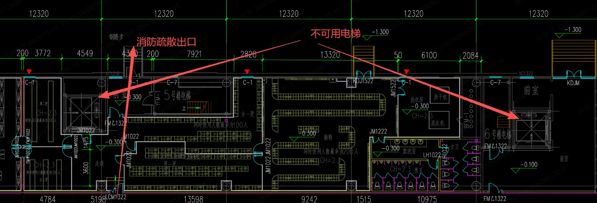
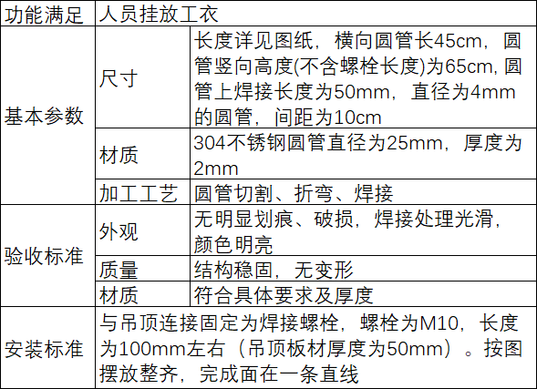

# 原始资料、设备参数与图块样式依据

更新时间：2026-11-17。长度统一为 mm；面积为 m²；容量统一以“可分配给多少名员工”表达，另外保存实物格数。

本文件的用途是让本地 Codex 找到真正的原始图片，分清哪些尺寸已知、哪些只能推算，并建立与用户原图一致的 CAD 图块。原始图片位于 [`references/original_images`](../references/original_images/)。图片应保留原字节，裁切、放大或描图另存，不覆盖原图。

## 1. 证据优先顺序

1. 用户最新明确说明：24 人鞋柜长 2000、宽 600；每面 8 列、3 层；一人使用脏侧与净侧各一格；可定制 12、18、24 人及上下叠放的 48 人柜；按原方案 S 形排布，横排和竖向连接均可用柜子；其他边界柜距矩形边界 1000；员工只能经跨柜完成脏净转换；手动调整默认正交。
2. 用户原始设备参数图片和原方案截图。涉及与最新口述不一致的字段，应同时保留原文和冲突标记，以最新已确认的容量口径控制本次计算。
3. 根据上述条件计算的名义模数、候选组合及布局结果。推算值必须带推算依据，不能标成厂家实测值。
4. 旧 AI 方案、旧代码和旧审查记录只能用于理解历史错误及制作回归用例，不可用于认定用户原图块。

本次保留了原方案截图和设备表，可以继续查看其中的图块表现。现有材料没有可直接导入的用户原始 DWG/DXF 块定义。后续本地开发可读取用户在本机选择的原 CAD/块库；也可先从这些图片建立明确标为“依据截图重建、待样式核对”的原型块。不得把后一种状态写成“已复用原块”。

## 2. 原始图片索引

| 文件 | 内容 | 可直接取得的资料 | 使用边界 |
| --- | --- | --- | --- |
| [01-18754.jpg](../references/original_images/01-18754.jpg) | 原方案西段 | 贵宾北侧入口、洗手消毒、风淋、磨刀及烘靴/更衣相关区域；原 CAD 的颜色、线条、门及设备符号表现 | 原图局部截图；红色文字、箭头为批注，不是墙、门或设备实体 |
| [02-18753.jpg](../references/original_images/02-18753.jpg) | 原方案东段 | 换鞋区 S 形连续柜带、圆弧回转、横竖柜段；男女一更、洗衣、卫生间及核心区的相邻关系 | 这是鞋柜布局形式的首要视觉参考；原图人数文字不能覆盖本次 300 当班、600 在册的任务条件 |
| [03-18752.jpg](../references/original_images/03-18752.jpg) | 原方案全长总览 | 东西关系、右上员工到达、主流程右向左、下方车间、北侧贵宾入口及各段关联 | 分辨率较低，适合核对全局关系，不适合反推毫米级设备内部线条 |
| [04-1794325020493.png](../references/original_images/04-1794325020493.png) | 更衣设施设备/建筑/电气/给排水/暖通总表 | 房间功能及设备类别、部分容量和尺寸、配套设施清单 | 为用户项目资料，不自动等同于现行规范条文；本轮不据其泛化出新房间 |
| [05-1794325039166.png](../references/original_images/05-1794325039166.png) | 双面凳式鞋柜参数 | 2000×600×600、304 不锈钢 1.0 厚、门 260×168、圆弧角半径 600/高 600、内嵌门和磁吸等 | “格数 24/48”“48 人鞋柜一体形式”措辞与最新口述存在口径差异；容量按最新口述。门宽与列距冲突见下文 |
| [06-1794325050916.png](../references/original_images/06-1794325050916.png) | 茶杯架/茶水柜参数 | 1500×150×1800，100 格，304 不锈钢 1.0 厚 | 100 格为杯位，不是 100 个更衣位；不由杯柜格数反算鞋柜人数 |
| [07-1794325063428.png](../references/original_images/07-1794325063428.png) | 一更个人衣柜参数 | 1140×500×2095；4 层、3 列、12 门；304 不锈钢；每门内部分层和储物配置 | 12 门对应 12 个个人柜位；柜内活动隔板不再增加人数。门扇厚度、净开口与开门包络需实际块/产品核对 |
| [08-1794325072598.png](../references/original_images/08-1794325072598.png) | 二更工装衣架参数 | 主架长度随图；横向圆管长 450；竖向高 650；挂钩长 50、直径 4、间距 100；管径 25、壁厚 2；吊顶连接 M10，约 100 长 | 450 是表列横向构件长度，不直接等于所有挂衣状态的外包宽度；端部余量、单双侧挂钩及具体支撑应由原图确认 |
| [09-1794325085750.png](../references/original_images/09-1794325085750.png) | 五位洗手池参数 | 1900×475×1110；5 位；感应/脚踏；一冷一热；304 不锈钢 1.0 厚；进水 DN15、排水 DN32 | “5 位”先保存为设备额定龙头位数，有效成人操作位需另核 |
| [10-1794325096089.png](../references/original_images/10-1794325096089.png) | 三位洗靴机参数 | 1870×615×950；3 位；刷辊 140×260；表列离地 300；304 不锈钢；把手带胶套 | 表内排水 DN32，黄色备注要求增至 DN50，保留修订关系；不可无视黄色备注而静默采用旧值 |

### 2.1 最重要的布局参考

这张图可确认以下形式特征：鞋柜不是若干互不相干的平行排；长横段、短竖段和回转端构成连续的蛇形柜带；柜带两侧可辨认相向的重复分格；回转外轮廓有圆弧。自动排布和手工拖动都应保留“连接柜也是柜、连接关系决定间距”的逻辑。

不能从该截图直接确认全部块名、嵌套结构、基点、每条内部线的精确坐标或圆弧内外边的定义。这些应从本地原 CAD 提取或按图片单独核对。

## 3. 鞋柜：容量口径与几何口径

### 3.1 最新确认的标准单柜

- 外包：长 2000，宽 600，高 600。
- 每一侧：8 列 × 3 层 = 24 格。
- 两侧合计：48 格；一名员工占脏侧 1 格、净侧 1 格，因此容量为 **24 人**。
- 名义模数：长向列距 `2000 / 8 = 250`；单侧深度 `600 / 2 = 300`；竖向层距 `600 / 3 = 200`。
- **250×300×200 是未扣板厚、框料、底座及面板的名义分格，不是单格净内尺寸。**

按相同列距、每侧 3 层的定制逻辑，可推算 12 人柜为 4 列、长 1000；18 人柜为 6 列、长 1500；24 人柜为 8 列、长 2000。横向尺寸不应通过整体非等比拉伸一个 24 人原块得到，应增减完整列模块并保持门、隔板、柜深和分格节距。

两只标准柜上下叠放，数量为 2 只实物柜、1 组占地、48 人储存容量、96 个脏净格；理论总高 1200，实际还应计连接/底座构造。堆叠并未使一个平面占地上同时可跨柜的人数翻倍。储存容量和跨柜操作能力是不同字段。

### 3.2 必须保留的原始冲突

原参数图记门尺寸 260×168。如果其中 260 是柜长方向门宽，则大于最新 `250` 列距；不能直接同时成立。即使把门的两个尺寸方向交换，也需要实物/原块确认，不可由程序自行交换后宣称问题已解决。

应保存：`door_dimensions_raw = [260,168]`、`door_dimensions_status = conflicting_or_unresolved`、`column_pitch_nominal = 250`。该问题不阻止人数计算、外包布置、手动拖动和候选拓扑开发；涉及逐扇门细节、制造图或开门动作核查时再解析。

### 3.3 圆弧转角

原参数图列明“半径 60 cm 的四分之一圆弧角，高度 60 cm”，即 R600、H600。现图没有完整的附属转角详图，也没有说明 R600 是内边、外边还是基准线半径。

插件应单独建转角构件/连接关系，允许绑定本地原弧角块；保留其外轮廓和接口坐标。转角的储物容量默认为 0，除非原块或产品明确具有可分配的脏净格。不得给每个圆角自动加 12 人或 24 人，也不得把左右回转都绘成同一套未经核对的尖角线。

## 4. 二更工装衣架：准确转录

| 参数 | 原表值 | 程序建模用途 |
| --- | --- | --- |
| 连续架长度 | 详见图纸 | 可编辑长度；根据实际挂钩序列和端部余量计算挂位 |
| 横向圆管长度 | 450 | 保存结构构件长度，作为平面占用建模的已知依据之一 |
| 竖向高度，不含螺栓 | 650 | 立面/三维及吊装数据；不能在平面中当成通道宽度 |
| 焊接挂钩 | 长 50、直径 4 | 挂点构造，不是 50 mm 人员间距 |
| 挂钩间距 | 100 | 挂点节距；实际端点布置和双面情况需明确 |
| 架体管材 | 304 不锈钢圆管，外径 25、壁厚 2 | 构件尺寸和物料属性 |
| 吊顶固定 | 焊接螺栓 M10，长约 100；吊顶板厚 50 | 构造资料；不作为结构承载计算完成的证据 |

计数应基于实际生成/导入的挂点。若长度为 `L`、两端预留为 `e1,e2`、第一挂点明确位于 `e1`，该排可按 `floor((L-e1-e2)/100)+1` 枚举；若产品采用“每 100 mm 一个计量单元”，则是另一套端点规则。两种口径不能混用。不得仅写 `L/100` 后随意向上取整。每条挂架是否单侧或双侧、每个挂点分配多少人，必须是有证据的配置。

## 5. 图块样式实施要求

### 5.1 原块优先

本地 Codex 应提供“选择原 DWG/DXF／从当前图中选块”的入口，读取该块的真实几何、单位、基点、属性、内部图层和必要的嵌套块；在项目块库中记录来源及版本。用户原块可在其本机使用，不要求为了插件运行把公司整张图纸上传。

按照原设备类型分别绑定块，不凭相近的矩形外形混用工装架、烘靴柜、鞋柜或衣柜。块名可能并非规范设备名，应由缩略图与设备类型映射确认。

### 5.2 平面投影不能代替立面分层

- 鞋柜每侧 8 列沿长边展开；3 层位于高度方向。不能在平面中再画 3 排占地来表示 3 层，也不能把两面共 48 格显示为 48 人。
- 一更 12 门柜为 3 列 × 4 层；在平面外包中沿长度保留原图的列分割及开门侧表现，不能把 12 门平均摊成 12 个平面小格。
- 工装架保存原图的长条骨架、挂点和支撑表达；挂点对应实际参数，不用随意密集的小齿线制造容量感。
- 原图出现的文字和设备数量注记需要映射为可更新属性，不能复制一串固定人数文字之后让实际柜型变化而文字不变。

### 5.3 图形、几何与统计分开保存

一只设备至少有三类数据：用于出图的原块、用于碰撞/操作检查的真实轮廓及操作面、用于人数统计的容量参数。块内有多少条线或多少个闭合多段线，不应直接当作人数。

自动排列可以平移、以 90° 为步长旋转，并按有定义的连接端进行组合；镜像必须同时变换脏/净侧标记和操作面。不可为填满矩形而压扁、加宽、缩小原图块。默认模型空间表达，不增加与本任务无关的图纸布局或填充。

### 5.4 样式验收材料

每类块至少生成一张“原图局部—本地原块或重建块—实际布置实例”的同尺度对照。对照项包括外轮廓、分格数量、列距、内线、圆角、基点、朝向、图层颜色/线宽及文字位置。状态明确分为 `original_block_imported`、`image_reconstructed_pending_review`、`approved_reconstruction`；未完成核对的块不能呈现“已与原图一致”。

## 6. 数据整理时禁止的误用

- 不把截图上的红色批注、疏散箭头和不可用电梯标记作为柜子、墙或插件生成对象。
- 不把原图的某处 100/200 人历史标注当成本次新项目人数。
- 不把旧 AI 方案的 115.84 m² 或用户所述原方案约 135 m² 当作所有矩形都能实现的固定面积公式。
- 不把画成 S 形自动等同于“不能绕过柜子”。必须对实际边界、连接端、1000 周边间距和脏净区域做连通性检查。
- 不把储存位、挂位、操作位、柜体数量、柜组数量和同时更衣人数混为一列。
