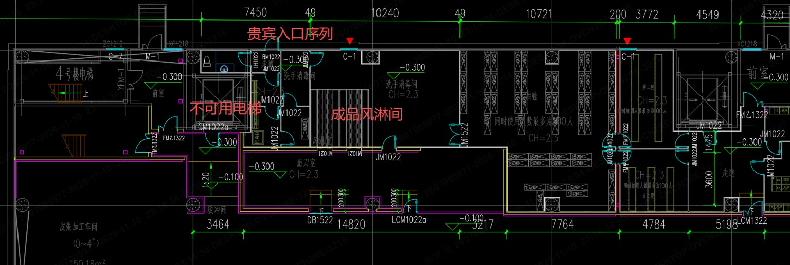
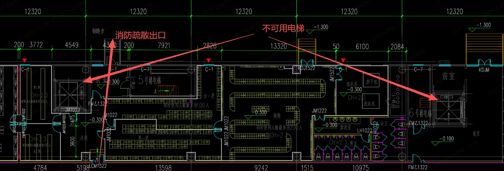
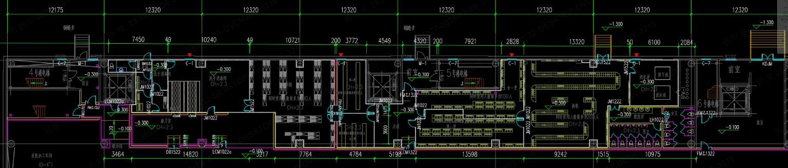
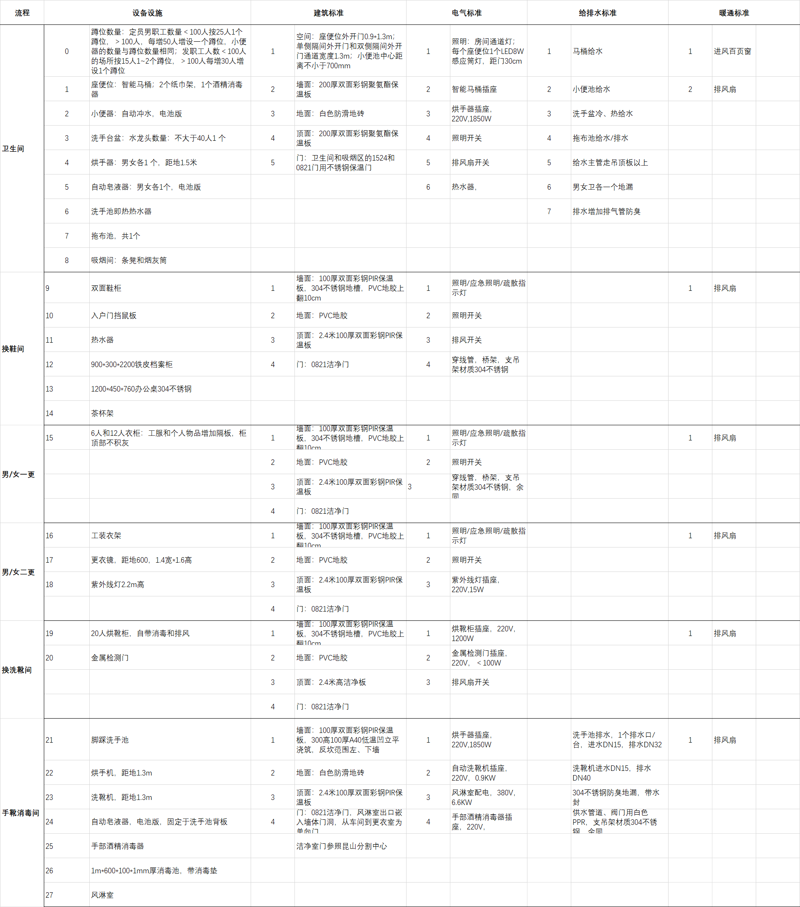
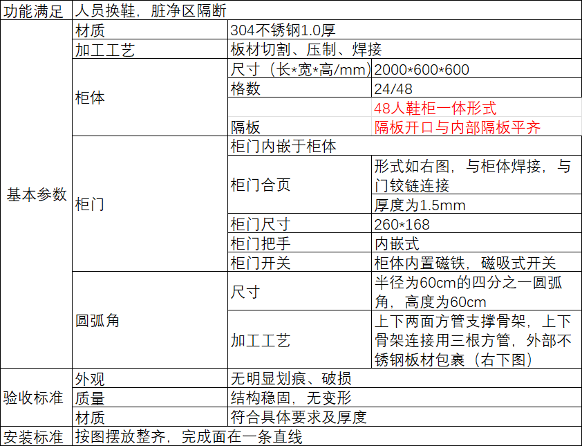
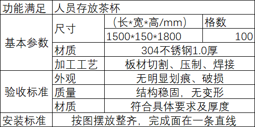
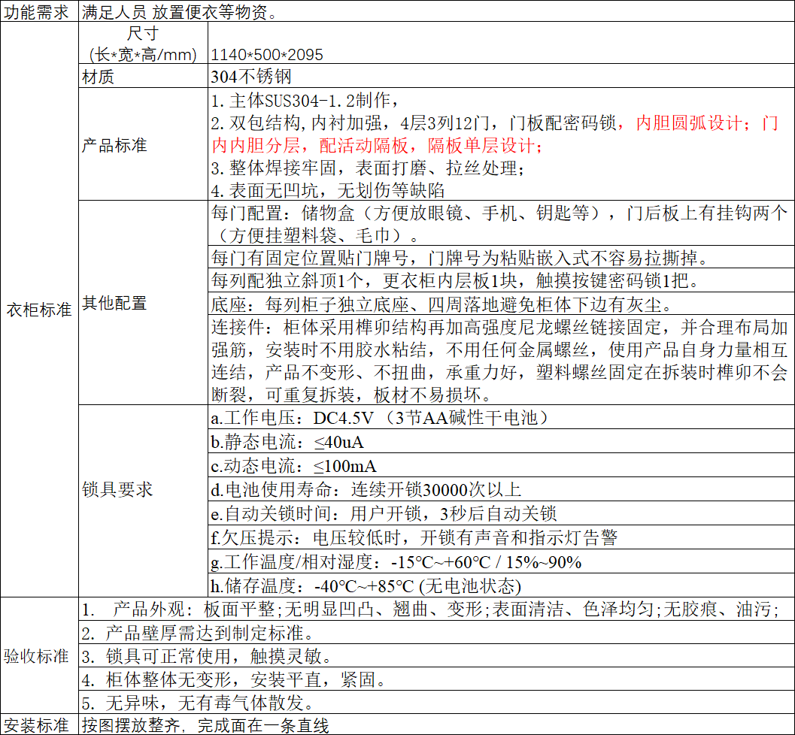
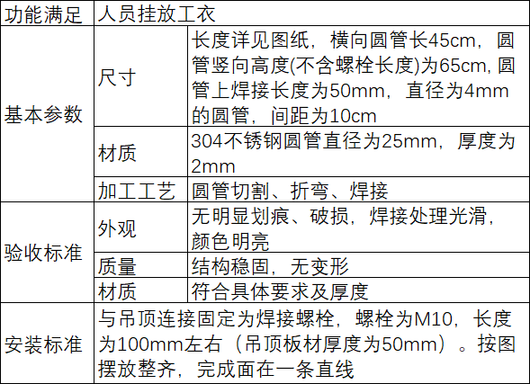
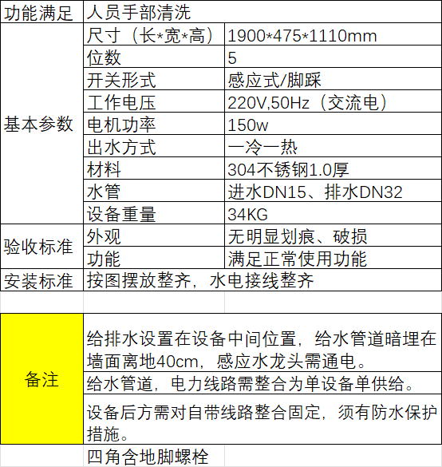
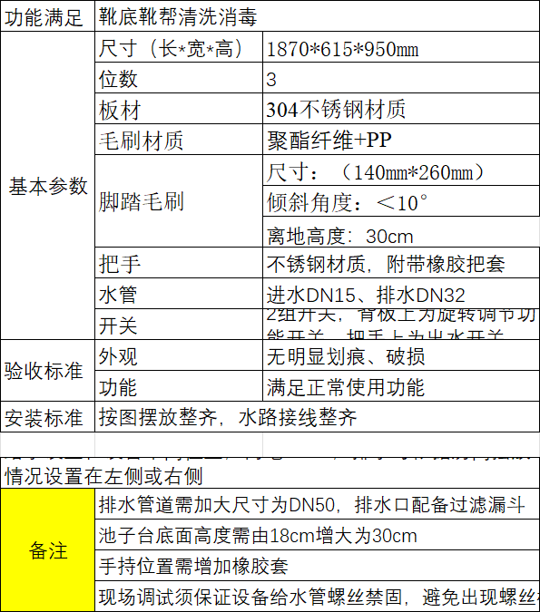

# 原始图片索引

本目录保留用户上传的原始图像字节；以下名称仅添加了序号，未把图片重画成新的块。图像SHA256见 [image_manifest.json](image_manifest.json)。

## 01｜原方案西段：贵宾、磨刀、洗消、烘靴及电梯接口

原文件：[下载/查看](original_images/01-18754.jpg)；SHA256 `ea59ed8bd238c25394dd8520d944a5012ebf5a5c9e529f1d50c55eafecf22237`。

## 02｜原方案东段：S形换鞋、男女一更、洗衣、卫生间

原文件：[下载/查看](original_images/02-18753.jpg)；SHA256 `caace2729017dab5efd851509bc08f0037b9c19f0e03afad77534ea643fc0f28`。

## 03｜原方案总平面：建筑核心、流程与尺寸链

原文件：[下载/查看](original_images/03-18752.jpg)；SHA256 `2e7339857a8ead6481dbfa025a5d2ee0364b80f308246fb9ee1d2c465f5a2597`。

## 04｜更衣设施总表：房间、设备及各专业条件

原文件：[下载/查看](original_images/04-1794325020493.png)；SHA256 `6698435aef56f886ff5d15eb5ce06bbe1afac61c16e28c574b439881096dc4fd`。

## 05｜双面凳式鞋柜参数及R600弧角

原文件：[下载/查看](original_images/05-1794325039166.png)；SHA256 `72e7070d5259a9c8beef9d0aa1982584609aca40005e622a2fdd91388b520060`。

## 06｜茶水柜参数

原文件：[下载/查看](original_images/06-1794325050916.png)；SHA256 `a668dbf5ccd39ba15a9e0b41a4185dded12638b62f404ef0f69a9123df75b2f0`。

## 07｜12门一更衣柜参数

原文件：[下载/查看](original_images/07-1794325063428.png)；SHA256 `139dc8022897c6cd8aee5e5ec64393b1b4b1c6802d5223ac7089c3ea26a286dc`。

## 08｜二更工装衣架参数

原文件：[下载/查看](original_images/08-1794325072598.png)；SHA256 `d396b2d952124e3e52440f0b8e21a67d618e2e463a56069b159b97962f04e0f1`。

## 09｜5位洗手池参数

原文件：[下载/查看](original_images/09-1794325085750.png)；SHA256 `6240411c27c585f8278f616eb3c3ce8b450b6a55690aafbb42800d0a9fa7e1a4`。

## 10｜3位洗靴机参数

原文件：[下载/查看](original_images/10-1794325096089.png)；SHA256 `199f8e9910bffbd1b96bf3011ed0b2dc7434248c362bca240c7654c10ee3f6a4`。
